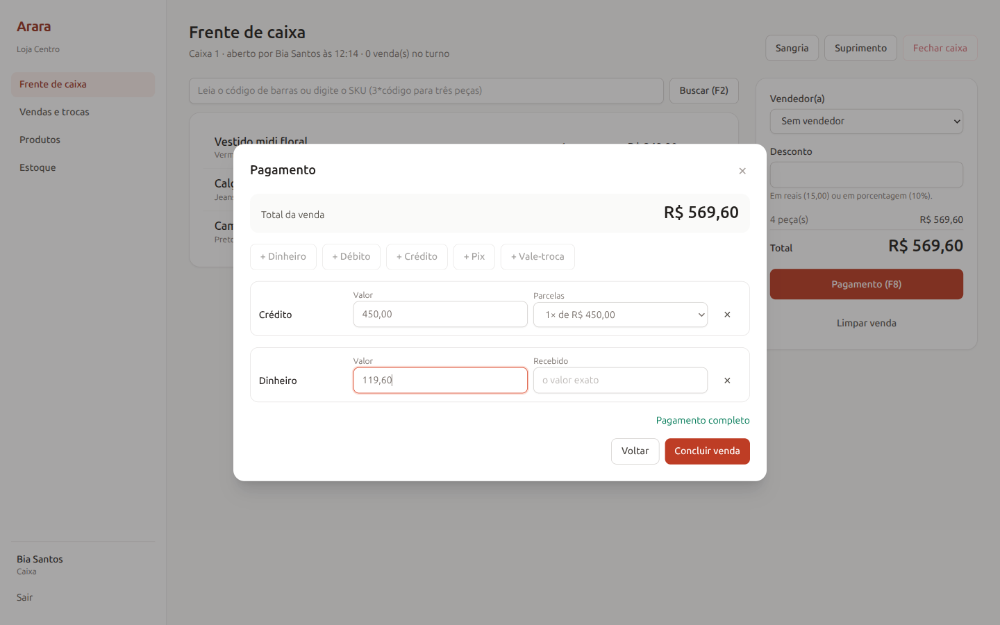
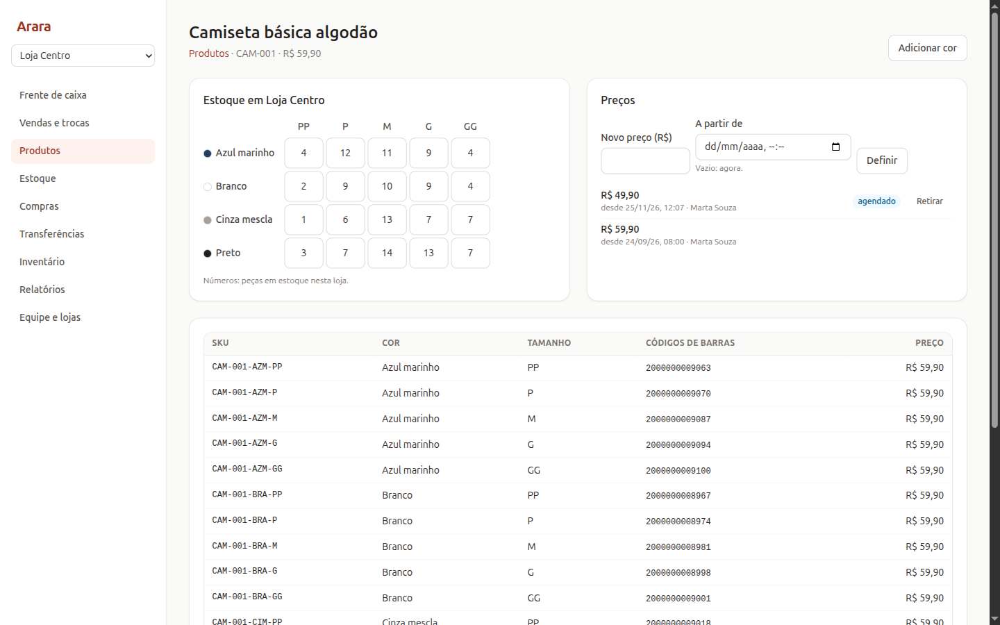
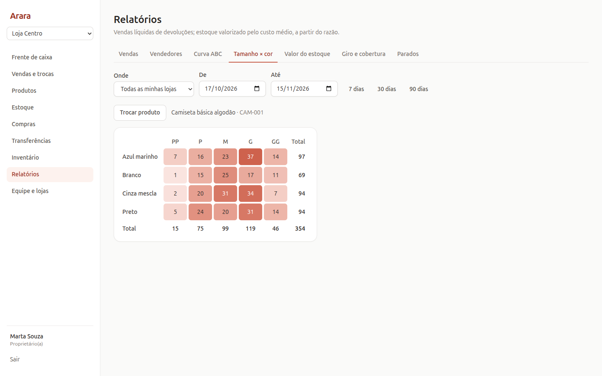
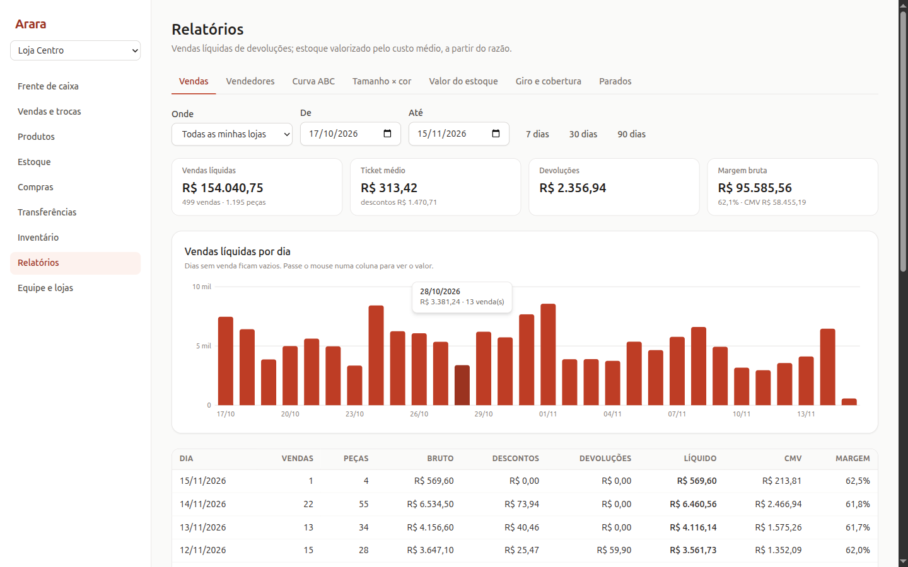
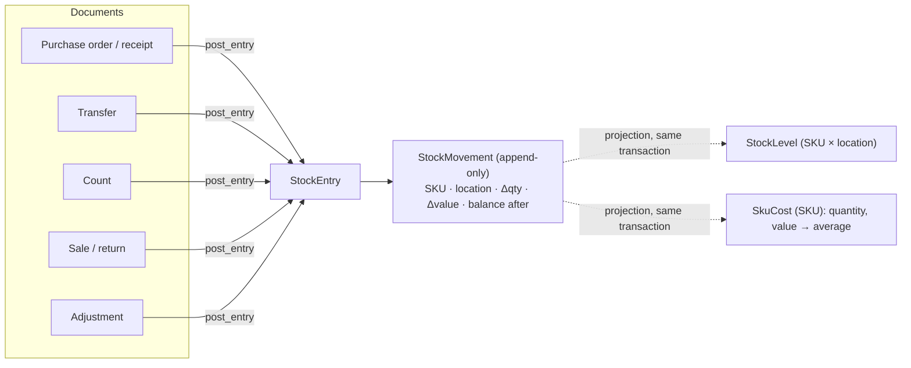

# Arara

Inventory, purchasing and point of sale for small clothing and shoe stores: products in a size × color grid, several stores and a warehouse, transfers, blind stock counts, a keyboard-first till and reports. The kind of system a small retailer pays a monthly fee for, built around careful data modeling.

The interface is in Brazilian Portuguese (the product is for Brazilian stores); code and docs are in English.

**Live demo: [arara-shelf.vercel.app](https://arara-shelf.vercel.app)**. Sign in with one click as the owner, a manager, a cashier or the stockist. The data is fictional and resets every night. The API runs on a free plan that sleeps when idle, so the first request can take about a minute.



## What it does

| | |
|---|---|
| **Catalog** | A product becomes a grid of SKUs (one color in one size), each with an internal EAN-13 (prefix 200–299, reserved for in-store use) plus any supplier barcodes. Prices are never edited: a new price starts at a date, so a sale can be scheduled. |
| **Stock** | An append-only ledger per SKU and location, enforced by PostgreSQL. Balances, restock targets, a movement history that explains every number, adjustments with a manager's approval. |
| **Cost** | Moving weighted average per SKU, company-wide. Every sale line freezes its cost, so margins and returns are exact months later. Stock value at any past date comes straight from the ledger. |
| **Purchasing** | Suppliers (including the alphanumeric CNPJ of 2026), orders, partial receipts against the invoice, receipt reversal, returns to the supplier, and restock suggestions that draft the orders in one click. |
| **Transfers** | Store ↔ warehouse through a transit location: goods on the road stay on the books, and what doesn't arrive becomes a recorded loss with a reason. |
| **Counts** | Blind counting by area while the store keeps selling: applying adds the difference measured when each SKU was counted, never overwriting sales made meanwhile. |
| **Point of sale** | Barcode scanner or typed SKU (`3*code` for three), split payments with change and installments, sale discounts spread to the cent, manager approval on the cashier's screen, cash in/out, cancellation, returns at any store with or without the receipt, store credit and exchanges, and a blind till closing. |
| **Reports** | Daily net sales and margin, salespeople, ABC curve, which sizes and colors sell, stock value at a date, turnover and coverage, stale stock. |
| **Roles** | Owner, manager, cashier, stockist, each limited to the stores they work at. Cashiers never receive cost or margin from the API, not just on screen. |

| Product grid and prices | Which sizes and colors sell | Daily sales |
|---|---|---|
|  |  |  |

## The data model in one picture



Every document writes through one function, `post_entry`, which takes the locks in a fixed global order, checks availability after locking and updates the projections in the same transaction. `manage.py check_stock` proves the projections equal the ledger; every stock test runs it too.

## Decisions

| ADR | |
|---|---|
| [0001](docs/adr/0001-stock-is-an-append-only-ledger.md) | Stock is an append-only ledger |
| [0002](docs/adr/0002-moving-average-cost-company-wide.md) | Moving average cost, company-wide (and what changes for cost per CNPJ) |
| [0003](docs/adr/0003-one-lock-order.md) | One global lock order |
| [0004](docs/adr/0004-blind-counts-apply-deltas.md) | Blind counts that apply deltas |
| [0005](docs/adr/0005-point-of-sale.md) | Point of sale: numbering, retries, returns and the till |
| [0006](docs/adr/0006-capabilities-not-roles.md) | Capabilities, not roles, in the code |
| [0007](docs/adr/0007-money-as-decimal-strings.md) | Money as decimal strings, cents in the browser |
| [0008](docs/adr/0008-public-demo.md) | A public demo with lived-in history |

## How it's tested

- **Against a real PostgreSQL**: CHECK constraints, partial unique indexes, the append-only trigger and row locks don't exist in a mock.
- **Races**: two threads behind a `Barrier`, with `lock_timeout` so a deadlock fails instead of hanging: the last piece sold by two tills, simultaneous receipts of one SKU (the average stays right), two people receiving the same last pieces of an order, sale numbering across tills, one manager approval claimed by two tills, two returns of the last unit. Mutation tests (removing a lock) confirm each one fails without its lock.
- **Hand-computed numbers**: costs across receipts at different prices, returns at the frozen cost, discounts spread to the cent, report totals by day in store time.
- **Query counts** pinned on the lists that used to grow with their rows.
- The OpenAPI schema is generated without warnings, and CI checks it.

## Stack

Django 6.1 · Django REST Framework · PostgreSQL 16 · React 19 · TanStack Query · Tailwind 4 · Vite · uv. Deployed on Render (API, Docker), Vercel (web app, which reaches the API through a same-origin `/api` rewrite so the session cookie is first-party) and Neon (PostgreSQL).

## Local development

```bash
docker compose up -d                     # PostgreSQL on :5436
cd backend
cp .env.example .env
uv sync
uv run python manage.py migrate
uv run python manage.py seed_demo        # a demo shop with weeks of history (password: arara-demo-2026)
uv run python manage.py runserver 8010   # API on http://localhost:8010/api, docs on /api/docs/

cd ../frontend
npm install
npm run dev                              # http://localhost:5174 (proxies /api to :8010)
```

Demo accounts (all `@arara.test`): `marta` owner, `rafael` and `lia` managers, `bia`, `davi` and `caio` cashiers, `joao` stockist.

## Checks

```bash
cd backend
uv run ruff check . && uv run ruff format --check .
uv run mypy .
uv run pytest                            # against the PostgreSQL above

cd ../frontend
npm run lint && npm run typecheck && npm test && npm run build
```

## Out of scope, and how the model leaves room for it

- **Fiscal documents (NFC-e/NF-e):** products already carry NCM, CEST and origin; a sale keeps items, prices and payments (installments, card brand, NSU) for a 1:1 fiscal record later.
- **Card receivables:** installments and NSU are recorded per payment.
- **Consignment ("condicional"):** a transfer to a customer location.
- **Cost per establishment (CNPJ):** see ADR 0002.
